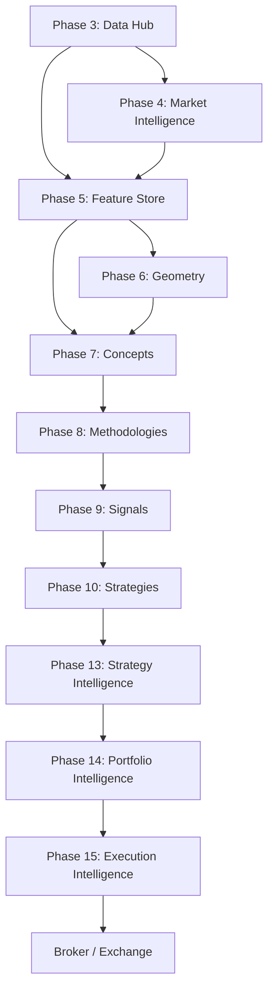
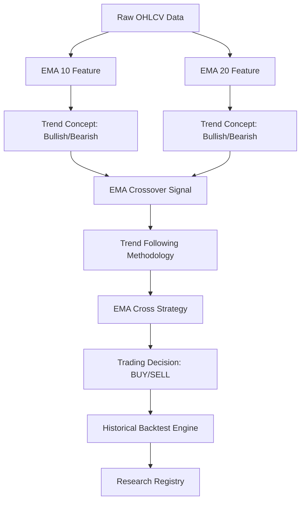
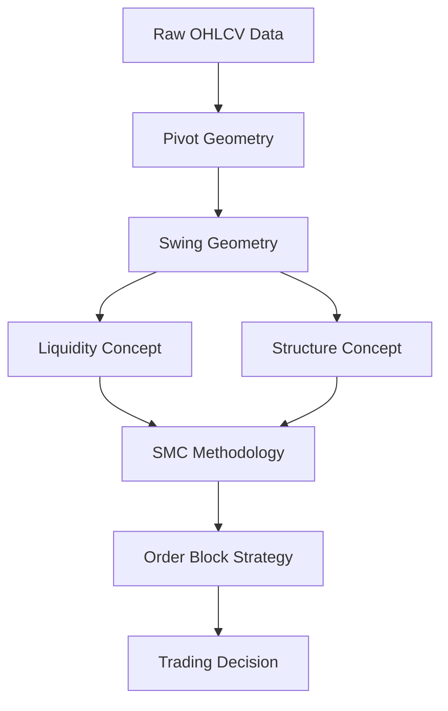

# Master Dependency Graph

This document illustrates the execution pipeline flow and topological dependencies of the AlphaGrid architecture. It maps how data transforms from raw ingestion up through the cognitive and execution layers.

## Canonical Runtime Flow

## Example: Trend Following Pipeline

This illustrates a concrete dependency chain for a specific capability (EMA Cross Strategy).

## Example: Market Structure Pipeline

*Note: This graph is the architectural intent. The actual runtime DAG is dynamically resolved by the Dependency Registry using the `depends_on`, `produces`, and `consumes` fields in the Master Capability Registry.*
