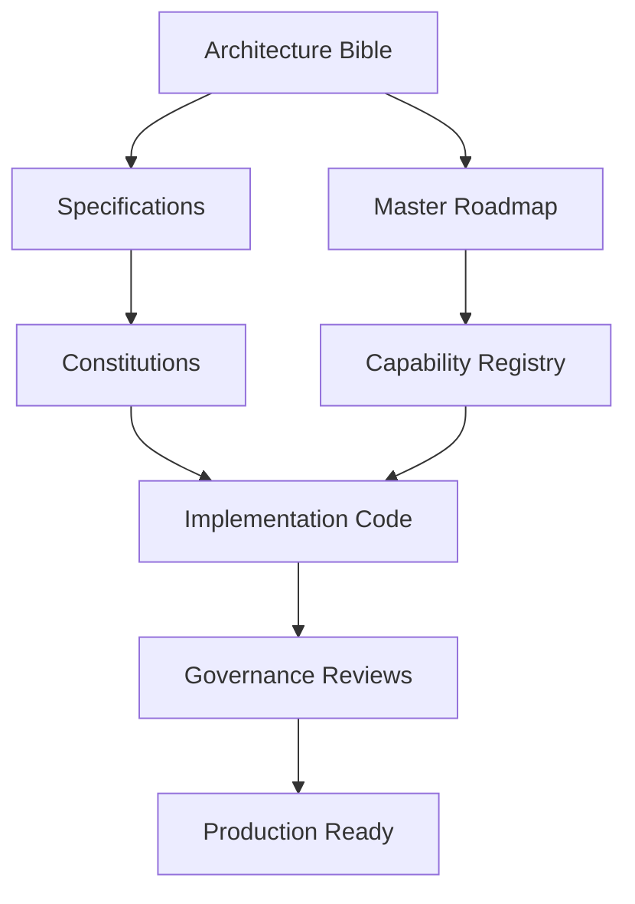

# Canonical Dependency Map

## 1. Purpose
Defines the explicit dependency relationships across the AlphaGrid documentation and execution ecosystem. It strictly prevents documentation cycles and ensures that downstream artifacts never dictate upstream design.

## 2. Allowed Document Dependencies
Changes to documents must cascade downwards. Upward dependencies are mathematically forbidden.

`Architecture Bible` -> `Specifications` (✓)
`Specifications` -> `Constitutions` (✓)
`Constitutions` -> `Governance` (✓)
`Governance` -> `Architecture` (✗ - ILLEGAL)
`Implementation` -> `Constitutions` (✗ - ILLEGAL)

## 3. The AlphaGrid Ecosystem Directed Acyclic Graph (DAG)

## 4. Subsystem Institutional Dependency Graph
Every active subsystem traces this exact path:
`Subsystem Idea` -> `Constitution` -> `Specification` -> `RFC` -> `ADR` -> `Implementation` -> `Unit/Integration Tests` -> `Evidence Package` -> `Governance Review`
