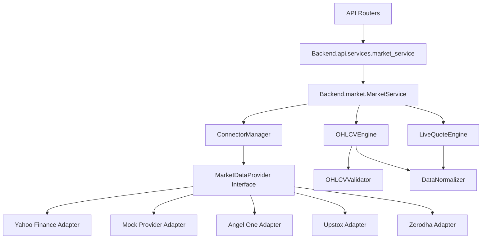

# Market Intelligence Platform

The Market Intelligence Platform (Phase 6) abstracts all market data ingestion, providing a unified, provider-agnostic interface to the rest of the application.

## Architecture

The system strictly decouples the interface from the implementation.

### 1. Provider Abstraction
All brokers/data sources must implement `MarketDataProvider` from `providers/base.py`. No component outside `providers/` imports specific brokers. This guarantees that swapping brokers (e.g., from Upstox to Angel One) does not require modifying any business logic.

### 2. Connector Manager
Maintains the registry of providers. It routes requests down the priority list. If `AngelOneProvider` raises a `ProviderUnavailable` exception, the manager automatically fails over to `YahooFinanceProvider` or `MockProvider`.

### 3. Normalization & Validation
- **Validator**: Drops bad data (e.g., negative volume, High < Low).
- **Normalizer**: Converts arbitrary broker data types into the standardized `Shared.models.market.MarketSnapshot` Pydantic model.

### 4. Engines
- **OHLCV Engine**: Manages historical data fetching.
- **Live Quote Engine**: Fetches live data and provides an in-memory fallback cache.
- **Market Breadth**: Calculates advance/decline ratios.
- **Regime Detector**: Purely rule-based regime classification (no ML here).
- **Session Manager**: Manages Indian market hours and holidays.

## Adding a New Provider

To add a new broker (e.g., Dhan):
1. Create `providers/dhan.py`.
2. Inherit from `MarketDataProvider`.
3. Implement `health_check`, `get_instruments`, `get_ohlcv`, and `get_live_quotes`.
4. Export it in `providers/__init__.py`.
5. Register it with the `ConnectorManager` in the dependency injection layer.
